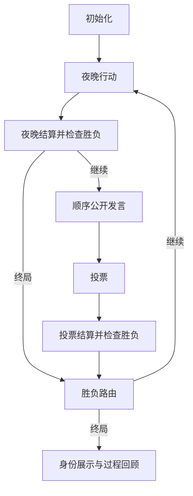

# WerewolfArena

支持真人与多个独立 AI 同台的狼人杀学习项目，使用 Python 3.11+、LangGraph、Pydantic 和 OpenAI 兼容 SDK。新版默认 12 人预女猎守，保留 8 人经典练习，提供本地圆桌网页与命令行两种入口。

## 网页版快速开始

```powershell
cd C:\Users\Mark\Desktop\WerewolfArena
.\.venv\Scripts\python.exe play_web.py
```

启动后自动打开 `http://127.0.0.1:8765`。在左侧选择板子和真人座位，在“接口与声线”中为每个 AI 选择模型，然后开始对局。轮到你时，底部面板会显示发言框、投票目标或专属技能。点击圆桌上的玩家也可以辅助选择目标。

```powershell
# 服务仅启动，手动打开页面
.\.venv\Scripts\python.exe play_web.py --no-browser

# 使用其他本地端口
.\.venv\Scripts\python.exe play_web.py --port 8766

# 12 人命令行游戏
.\.venv\Scripts\python.exe main.py

# 保留原有 8 人局
.\.venv\Scripts\python.exe main.py --preset classic8
```

网页默认玩家 1 为真人，其余 11 名自动使用 `.env` 中的模型接口，未配置任何接口时使用离线策略。选择“全 AI · 观战”可自动运行。浏览器刷新后，同一标签页会恢复当前游戏。游戏状态保存在服务内存，重启服务后可重新开局。每局公开过程保存到项目 `logs/`。

## 研究确定的角色与房规

12 人局采用 4 狼人、4 村民、1 预言家、1 女巫、1 猎人、1 守卫。狼人全部出局时好人获胜，村民或神职任一边全部出局时狼人获胜。8 人局继续使用 2 狼人、1 预言家、5 村民及原有人数优势判定。配置来源与房规差异见 [研究总结](docs/RESEARCH.md)。

- 女巫整局解药、毒药各一瓶，同一夜仅用一种药，不能自救。解药可用时知道本夜刀口，使用后停止提供新刀口。
- 守卫可空守、自守，不能连续两夜守同一玩家。守护挡狼刀，毒药穿守，同守同救仍导致目标死亡。
- 猎人被刀或放逐后可以选择开枪，被毒后不能开枪。处理完猎人响应，再按最终状态检查胜负。
- 12 人局狼刀可选择任意存活目标，包括策略性自刀。8 人局保留原有目标限制。
- 白天按存活编号发言，默认两轮。平票无人出局，狼人意见分歧由最小存活狼人 ID 裁决。

本版的警长、自爆和特殊狼角色列为后续扩展。各平台房规存在差异，实际实现采用上面明确的版本。

## 角色专属 skill

`role_skills/` 中每个角色都有独立 `SKILL.md`。身份随机分配后，`GameEngine` 加载对应文档，放入本人 `PlayerView`。LLM 调用把本人 skill 全文注入 system Prompt，包含策略目标、信息边界、技能约束和参考来源。离线 Agent 使用对应的 Python 策略实现，二者共享同一套确定性规则。

可编辑角色文档调整 LLM 的策略，再重启服务加载最新内容。离线策略权重与目标选择仍在 `agents/strategy.py` 和 `agents/player.py` 中调整。 [策略编写说明](STRATEGY_GUIDE.md)

## 逐 Agent API 配置

网页“接口与声线”为每个座位提供独立选择，支持离线策略和任意满足 JSON 输出要求的 OpenAI 兼容接口。可以混用不同 API 地址与模型，同一接口配置共享连接池，每名 Agent 仍拥有自己的上下文和记忆。

添加接口时填写配置 ID、名称、Base URL、模型名和环境变量名。网页输入的 Key 只在当前服务进程的内存中保存，也可在本地 `.env` 中填写对应变量。`providers.json` 只保存非敏感元数据，示例见 `providers.example.json`。

### 多个 DeepSeek Key 交叉分配

支持直接使用 `DEEPSEEK_API_KEY`、`DEEPSEEK_API2`、`DEEPSEEK_API3` 等变量，编号按数字排序，可继续增加。这些编号 Key 共用 `DEEPSEEK_BASE_URL`、`DEEPSEEK_MODEL` 和 `DEEPSEEK_*` 请求参数，单独使用各自的密钥。

```dotenv
DEEPSEEK_API_KEY=第一组密钥
DEEPSEEK_API2=第二组密钥
DEEPSEEK_API3=第三组密钥
DEEPSEEK_BASE_URL=https://api.deepseek.com
DEEPSEEK_MODEL=deepseek-flash
```

默认玩家 1 为真人时，玩家 2 使用第一组、玩家 3 使用第二组、玩家 4 使用第三组、玩家 5 再使用第一组，循环分配。留空的编号 Key 自动跳过，每位 AI 在一局中固定使用分配到的配置。网页逐座位选择或 `AGENT_编号_PROVIDER` 可固定某个接口，例如 `deepseek_2` 对应 `DEEPSEEK_API2`，固定座位跳过自动循环。

补填 Key 后重启升级后的服务，点击“所有 AI 跟随 .env”可应用交叉分配。设置列表显示每个座位的具体 API 编号，开局后的玩家悬停信息显示实际分配。每局全部接口共用至少 1 秒的请求间隔。

### 直接在 .env 添加多个模型

每个 OpenAI 兼容服务使用相同前缀的一组配置，程序自动发现接口。配置 ID 为小写前缀，例如 `QWEN_*` 对应 `qwen`。服务需要支持 Chat Completions 与 JSON 模式，模型名填写服务商实际提供的名称。

```dotenv
LLM_DEFAULT_PROVIDER=deepseek
DEEPSEEK_API_KEY=你的密钥
DEEPSEEK_BASE_URL=https://api.deepseek.com
DEEPSEEK_MODEL=deepseek-flash

QWEN_API_KEY=你的密钥
QWEN_BASE_URL=https://dashscope.aliyuncs.com/compatible-mode/v1
QWEN_MODEL=服务商提供的模型名

AGENT_2_PROVIDER=deepseek
AGENT_3_PROVIDER=qwen
LLM_TEMPERATURE=0.9
```

默认路由按“网页显式选择 → AGENT_编号_PROVIDER → LLM_DEFAULT_PROVIDER → 已填凭据的接口”确定，最后一步优先 DeepSeek。默认选择 DeepSeek 时，已填写的主 Key 与编号 Key 按 AI 座位顺序循环分配，真人和固定指定接口的座位跳过。全部未配置时使用离线策略。显式指定的接口缺少 Key 或不存在时，开局给出配置提示。真人座位使用本人输入。

已有 `providers.json` 中同 ID 的接口保留网页保存的元数据，其凭据仍按 `key_env` 读取。为新服务使用独立前缀即可自动发现。

补填 `.env` 后，打开“接口与声线”会刷新接口列表。点击“所有 AI 跟随 .env”清除浏览器逐座位覆盖，下一局使用环境配置。已有对局的接口在开局时固定。旧版浏览器的离线选择首次升级会迁移为跟随 `.env`，之后仍可手动选择离线策略。

公开发言显示 `API`、`离线` 或 `API 失败 · 离线降级`。鼠标悬停发言标题或玩家座位可查看本局实际配置与模型。填有凭据只代表可以发起请求，服务连通性和额度由真实调用验证。夜间每位玩家的调用状态和行动统计仅保存在后台，终局展示总降级次数。

`LLM_TIMEOUT`、`LLM_MAX_RETRIES`、`LLM_MAX_TOKENS`、`LLM_TEMPERATURE` 适用于全部接口。可用 `QWEN_TEMPERATURE` 等前缀参数覆盖单接口设置。温度默认 0.9，实际范围遵循服务商要求。官方 DeepSeek 当前模型自动采用非思考模式，可用 `DEEPSEEK_THINKING=enabled` 开启深度思考并相应增加输出预算和超时。其他接口默认沿用服务商行为，显式 THINKING 配置适用于支持 DeepSeek thinking 协议的接口。浏览器只收到凭据是否已填写，实际 Key 由 Python 后端读取。

命令行默认 `--mode auto`，使用相同的逐座位路由。`--mode deepseek` 按可用 DeepSeek Key 循环分配，`--mode mock` 使用离线策略。

DeepSeek 思考模式、温度参数与 SDK 扩展字段的行为依据官方文档实现。 [DeepSeek 思考模式](https://api-docs.deepseek.com/guides/thinking_mode/)

## 语音与卡通圆桌

网页默认开启“语音发言”，默认 1.3 倍语速，顶栏可切换 0.8 / 1.0 / 1.3 / 1.6 / 2.0 倍。系统语音按完整句子合成，减少分段停顿。发言展示停顿默认 1 秒。你提交发言后，下一位 AI 开始语音，字幕随播放逐步显示。Python 主持人等待本条播放确认后才调用下一位，最后一位播完才继续收集选票。关闭声音后，文字按阅读速度逐字显示，也会等待显示完成。点击“跳过本条”可完整显示当前内容并继续，失败时可点击“重试语音”。刷新页面可恢复当前待播放发言。

每位玩家的声线只提供“温柔男声”“温柔女声”“豆包声色”三个入口，默认交替使用两种本机声线。本机预设自动匹配系统中文男/女声并调整语速、音调，实际音质取决于已安装声库。本机字幕使用语音边界事件校准，缺少边界事件时按短句内的语速估算平滑显示，并在真实音频结束时完成该句。

豆包是可选云语音服务，在 `.env` 中填写 `DOUBAO_TTS_API_KEY`，或旧版 `DOUBAO_TTS_APP_ID` 与 `DOUBAO_TTS_ACCESS_TOKEN`。资源与音色可通过 `DOUBAO_TTS_RESOURCE_ID`、`DOUBAO_TTS_SPEAKER` 指定。填好配置后打开“接口与声线”可刷新可用状态，明确选择豆包声色才会请求云合成。豆包字幕按返回的字级时间戳跟随实际音频播放。本版默认音色 ID 沿用官方示例，可换成你在控制台有权限使用的音色。

大模型生成文字和云服务文字转语音分别计费。豆包提供需要在控制台领取的试用额度，具体额度和有效期以账户控制台为准。本机温柔男声、温柔女声使用系统语音，语音部分无需云 API 费用。 [豆包官方合成文档](https://docs.volcengine.com/docs/doubao-voice/unidirectional-streaming-text-to-speech-http?lang=zh) [豆包官方计费说明](https://docs.volcengine.com/docs/doubao-voice/billing-overview?lang=zh)

夜晚开始后，非狼人视角显示全屏黑色闭眼界面。轮到本人夜间技能时，只开放本人的技能操作面板，预言家、女巫、守卫和夜间猎人响应仍可正常完成。狼人保持自己的夜间操作视图，天亮后恢复圆桌。

角色图集由 ImageGen 制作，素材与提示词见 [素材说明](docs/ASSET_SOURCES.md)。

未知座位统一使用中性卡通外观，真实角色只在本人面板、公开发动的猎人技能或终局亮牌时展示，头像选择保持与隐藏底牌分离。

## 详细流程图与源码阅读

- [用户输入流程图 HTML](docs/USER_INPUT_FLOW.html) 可直接在浏览器打开。
- [用户输入流程与 Mermaid 图](docs/USER_INPUT_FLOW.md) 给出开局、等待输入、校验、技能结算与网页输出的具体路径。
- 网页顶栏“流程图”提供相同逻辑的可视化速览。
- 源码已补充模块、类、函数与关键边界注释，建议按流程文档的阅读顺序理解。

## 真人参与与顺序发言

直接运行进入真人模式，角色随机分配。你的身份、狼人队友和查验结果在本机终端以 `【仅你可见】` 提示。每次轮到你行动时，程序等待输入，非法目标会重新提示。出局后继续观看公开过程。

白天默认发言两轮，每轮按存活玩家 ID 升序进行。第一轮提出证据和问题，第二轮回应质疑、对跳和投票建议。死亡玩家的编号会跳过。可用 `--discussion-rounds 1` 调整为一轮。

```text
第 1/2 轮发言，顺序为 玩家 1 → 玩家 3 → 玩家 4 → …
玩家 1：我准备投玩家 7，请他解释查验顺序。
玩家 3：我会核对双方的身份声明。
…
第 2/2 轮发言，顺序为 玩家 1 → 玩家 3 → 玩家 4 → …
```

发言时可输入自由文本，选择技能或投票目标时输入玩家编号。终端支持 `/help`、`/status`、`/history`、`/pass` 和 `/quit`。`/pass` 可用于公开发言或狼人私聊。输入结束时游戏停止，真人决策始终由终端输入提供。

```powershell
# 你作为玩家 1 参与，其余玩家跟随 .env
.\.venv\Scripts\python.exe main.py

# 你作为玩家 1，其余玩家使用 DeepSeek
.\.venv\Scripts\python.exe main.py --mode deepseek

# 选择其他座位
.\.venv\Scripts\python.exe main.py --human 3

# 全 AI 自动对局
.\.venv\Scripts\python.exe main.py --auto --seed 42
```

## 博弈策略

离线 AI 已加入预言家对跳、狼人伪装、查验声明的可信度、公开承诺与实际投票的核对、狼人击杀协作，以及特定人格在队友面临多数票时的切割。公开查验声明作为待验证信号处理，本人的私有查验具有更高优先级。重复同一声明按一次证据计算。

LLM 发言上下文包含最近六条公开发言、本人最近三次发言和最近针对自己的提问，并保持每个座位的表达偏好。模型依据原始发言选择追问、反驳、试探、辩护或拉票，后续轮次回应具体质疑并解释态度变化。投票和技能目标继续获得本人视图推导的策略分析。

策略扩展方法、参数含义与代码示例见 [STRATEGY_GUIDE.md](STRATEGY_GUIDE.md)。

## 开发状态

| 阶段 | 已实现内容 | 验证 |
| --- | --- | --- |
| 1 | 角色与人格初始化、夜间行动、发言、投票、胜负规则 | 基础规则及信息隔离测试 |
| 2 | PlayerAgent、MockAgent、私下交流、自动完整游戏 | 100 个随机种子完成整局 |
| 3 | DeepSeek SDK、JSON 输出、Pydantic 校验、重试与降级 | 真实 SDK 配合本地 HTTP 模拟响应 |
| 4 | LangGraph 流程编排与终局路由 | 50 个随机种子与 Python 顺序流程结果一致 |
| 5 | 独立记忆、身份与人格 Prompt、日志、终局回顾 | CLI 和公开／私有日志回归测试 |

真实 API 可通过默认自动模式或 `--mode deepseek` 联调。自动化测试使用显式离线配置与模拟 HTTP 响应。

## 快速运行

在桌面项目目录打开 PowerShell，创建虚拟环境并安装依赖。

```powershell
cd C:\Users\Mark\Desktop\WerewolfArena
python -m venv .venv
.\.venv\Scripts\python.exe -m pip install -r requirements.txt
.\.venv\Scripts\python.exe main.py --seed 42
```

已安装依赖的解释器可以直接运行 `python main.py`。默认由你控制玩家 1，其他座位自动使用已配置模型，通过 LangGraph 执行到胜负或平局，并显示全部身份与关键事件回顾。使用 `--auto` 可由 AI 控制所有座位。

```powershell
# 真人参与的离线游戏
.\.venv\Scripts\python.exe main.py --mode mock

# 可复现的全 AI 离线游戏
.\.venv\Scripts\python.exe main.py --mode mock --auto --seed 42 --max-rounds 10

# 同时写入管理员调试日志
.\.venv\Scripts\python.exe main.py --auto --seed 42 --debug

# 使用相同规则的 Python 顺序流程，便于学习和调试
.\.venv\Scripts\python.exe main.py --seed 42 --workflow python

# 执行全部离线测试
.\.venv\Scripts\python.exe -m unittest discover -v
```

如果当前解释器创建 venv 时遇到 ensurepip 错误，可以通过已可用的全局 pip 完成初始化。

```powershell
python -m venv --without-pip .venv
python -m pip --python .venv\Scripts\python.exe install pip -r requirements.txt
```

## DeepSeek 配置

将 `.env.example` 复制为项目根目录的 `.env`，填写 API Key。已有 `.env` 时直接编辑。

```dotenv
DEEPSEEK_API_KEY=
DEEPSEEK_BASE_URL=https://api.deepseek.com
DEEPSEEK_MODEL=deepseek-flash
LLM_TIMEOUT=60
LLM_MAX_RETRIES=2
LLM_MAX_TOKENS=2048
LLM_TEMPERATURE=0.9
```

```powershell
.\.venv\Scripts\python.exe main.py --mode deepseek
```

`.env` 按项目所在目录定位，环境变量优先级更高。API Key 在本地配置文件中填写，`.gitignore` 已排除 `.env`。DeepSeek 官方文档当前示例使用 `deepseek-flash`，具体模型可在 `DEEPSEEK_MODEL` 调整。

同一局的所有 AI 接口共用请求节拍器，上一次请求结束后至少等待 1 秒再发起下一次，覆盖不同模型、夜间行动和重试。每次模型调用设置超时，默认最多重试 2 次。网络、限流、服务错误和输出校验失败会触发有界重试，随后由 MockAgent 提供合法降级动作。401、402、403、404 响应会暂停本局后续模型请求，连续 3 次决策失败也会暂停请求，游戏继续通过降级动作完成。日志按 HTTP 状态、网络超时、JSON 格式、输出字段及行动校验区分失败原因，网页对局日志也保存这些脱敏警告。成功决策清零连续失败计数。终局显示降级次数、请求次数和服务已报告的 token 用量。

固定 seed 可复现全 AI 的 MockAgent 游戏。真人参与的结果还受到你的输入影响。真实模型输出还会受到服务端采样与模型版本影响。

## 目录

```text
WerewolfArena/
├── main.py                    # 真人／全 AI 模式、CLI 与终局展示
├── play_web.py                # 网页启动入口
├── config.py                  # 游戏配置及 .env 读取
├── game/
│   ├── engine.py              # 行动执行、结算、事件与记忆写入
│   ├── state.py               # 真实状态与不可变玩家视图
│   ├── rules.py               # 纯 Python 规则计算与校验
│   ├── runner.py              # 主持人调用 Agent，执行合法决策
│   └── reporting.py           # 日志设置与终局回顾
├── agents/
│   ├── player.py              # PlayerAgent、MockAgent 与内部决策对象
│   ├── human.py               # 真人输入、私有信息显示和终端命令
│   ├── skills.py              # 抽取身份后加载对应角色策略文档
│   ├── strategy.py            # 可见证据、怀疑分数与可调权重
│   ├── prompts.py             # 身份、人格与各类行动 Prompt
│   ├── schemas.py             # Pydantic 模型输出结构和语义校验
│   └── memory.py              # 独立记忆与不可变事件
├── llm/
│   ├── client.py              # 兼容 SDK、重试和 LLMPlayerAgent
│   └── profiles.py            # 逐 Agent 接口配置与内存密钥
├── workflow/
│   └── graph.py               # LangGraph 流程图
├── web/
│   ├── server.py              # 本机 HTTP 与静态文件服务
│   ├── session.py             # 游戏线程、输入等待与白名单快照
│   └── static/                # 圆桌 HTML、CSS、JS、语音与卡通图集
├── role_skills/               # 六份身份专属 SKILL.md
├── docs/                      # 攻略研究、流程图、素材和阅读说明
├── tests/                     # unittest 离线测试
├── logs/                      # 每次运行的公开日志与可选管理员日志
├── .env.example
├── providers.example.json     # 兼容 API 配置示例，实际 Key 写入 .env
├── .gitignore
├── requirements.txt
├── README.md
└── STRATEGY_GUIDE.md           # 博弈策略编写说明
```

## 工作流



LangGraph 节点调用 `GameRunner` 和 `GameEngine`，图状态保存轮次、阶段和结果。主持人真实状态保存在引擎中，图编排的输出保持为流程元数据。每次结算由引擎立即判定胜负，工作流依据结果选择下一节点。Python 顺序流程复用相同的行动函数，可以对照学习与验证行为。

当前运行状态保存在内存中。游戏中断后，已发生的公开过程可以从日志查看，重新运行会开始新一局。

## 关键架构

### 决策与执行

Agent 使用同一 `PlayerAgent.decide(view, action, candidates)` 接口。主持人提供本人视图和合法候选目标，Agent 返回 `Decision`。模型响应先通过 Pydantic 结构与行动语义校验，再由主持人调用确定性的引擎方法。

`rules.py` 负责校验和计算，`engine.py` 在校验成功后写入真实状态。这让规则测试可以独立运行，并允许不同 Agent 和工作流复用相同的执行路径。非法行动抛出 `InvalidAction`，保留原状态。

### 信息隔离与独立记忆

`GameState` 保存所有角色和待结算行动，仅供主持人使用。`PlayerView` 通过字段白名单构造，仅包含本人身份、人格、公开玩家状态、公开事件、本人的私有笔记、查验和怀疑判断。狼人额外知道队友 ID。

每位玩家拥有独立的记忆容器。公开历史同步到各自记忆，私聊仅写入存活狼人记忆，查验仅写入预言家记忆，怀疑判断仅写入本人记忆。视图、事件和查验记录使用冻结 dataclass 与 tuple，Agent 获得的是不可变快照。

每次 LLM 调用从该玩家的最新视图重建上下文，发言历史作为游戏数据写入用户消息。共享的 SDK 客户端提供网络连接，每位 LLMPlayerAgent 的对话信息通过自己的视图传入。角色与人格在 system Prompt 中分别指定，狼人可通过公开发言进行伪装，预言家可自主决定是否公开查验结果。

这属于应用层数据隔离，扩展 Agent 时需要持续使用视图接口。

### 日志与展示

普通运行生成 UTF-8 的 `logs/game_时间_唯一标识.log`，记录公开发言、结算票型、死亡事件和终局展示。公开日志在游戏结束后列出全部身份。

`--debug` 额外生成 `logs/admin_时间_唯一标识.log`，包含初始和最终真实状态、狼人私聊、击杀提议、查验及私有决策。该文件适合开发者复盘。普通控制台继续显示公开过程。

每次运行使用独立日志名。`--log-dir` 可调整输出目录。公开异常日志使用通用提示和异常类型，行动玩家及技能类型写入管理员日志，保持夜间身份信息的隔离。API Key 的配置表示经过隐藏处理。真人终端的私有提示通过独立输出通道显示，AI 上下文与公开日志记录已公开的游戏事件。

## 规则细节

- 角色按所选板子随机分配，ID 为 1 到本局人数。人格从激进、谨慎、逻辑、领导、怀疑五种类型中随机选择。
- 一轮为一夜和随后的白天。每名存活狼人进行一次私下发言，再分别提交击杀意见。意见分歧时采用存活狼人中 ID 最小者的选择，原队长死亡后顺延。
- 狼刀目标按板子限制执行。预言家每夜查验一名其他存活玩家，结果为真实阵营。
- 夜间行动同时生效，因此当夜被击杀的预言家仍可完成当夜查验。
- 夜间公布死亡玩家 ID。白天存活玩家按 ID 顺序循环发言，CLI 默认两轮，完成配置的所有轮次后进入投票。程序内直接创建 `GameConfig` 时默认一轮，便于兼容已有规则调用。
- 每人投给一名其他存活玩家。收齐后统一公开票型，最高票唯一则放逐，并列则无人出局。
- 每次夜晚与投票结算后检查胜负。狼人全灭好人获胜，存活狼人数量大于或等于存活好人数时狼人获胜。
- 最大轮数在当轮投票结算后检查，阵营胜负判定优先，达到上限且胜负未定时判平局。
- 已结束游戏拒绝后续行动，死亡玩家参与行动会被拒绝。每轮临时状态清空，历史记忆继续保留。

## 测试覆盖与已验证环境

使用标准库 unittest、HTTP 模拟传输与 CLI 子进程测试，测试全程离线。

- 角色分配、seed 复现、夜间技能权限、非法目标和重复行动。
- 狼人队长裁决、私聊次数、预言家同夜查验、死亡玩家限制。
- 发言顺序、票型完整性、唯一最高票及局部／全部并列。
- 双方胜利、夜晚直接终局、最大轮数和平局。
- 独立记忆、不可变视图、真实身份隔离、待结算选票隔离。
- 100 个离线游戏种子，50 个种子的两种编排方式一致性。
- SDK 请求格式、严格结构化输出、空白／截断输出、非法目标与限流。
- 超时、鉴权失败、服务失败暂停请求及合法降级。
- 正常 CLI、管理员模式、日志私有信息边界和终局回顾。
- 真人三种身份参与、输入校验、私有技能结果、主动退出和完整交互式 CLI。
- 多轮编号顺序、公开声明可信度、投票承诺、狼人伪装、协作与切割。
- 12 人角色数量、逐身份 skill、女巫药物、守卫保护与猎人延后结算。
- 真实 HTTP 输入提交、请求去重、本人视角隐私、六种真人身份和逐座位 API 配置。
- 前端 JS 语法与串行语音队列，语音开发测试在存在 Node 时执行。

实际验证使用 Windows、Python 3.14.8。源码通过 Python 3.11 语法检查，Python 3.11 的运行验证待相应解释器可用时完成。

## 参考文档

- [DeepSeek 官方接入说明](https://api-docs.deepseek.com/)
- [DeepSeek JSON 输出](https://api-docs.deepseek.com/guides/json_mode/)
- [OpenAI Python SDK 官方文档](https://developers.openai.com/api/reference/python)
