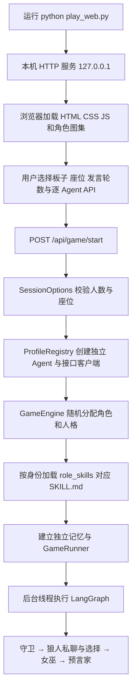
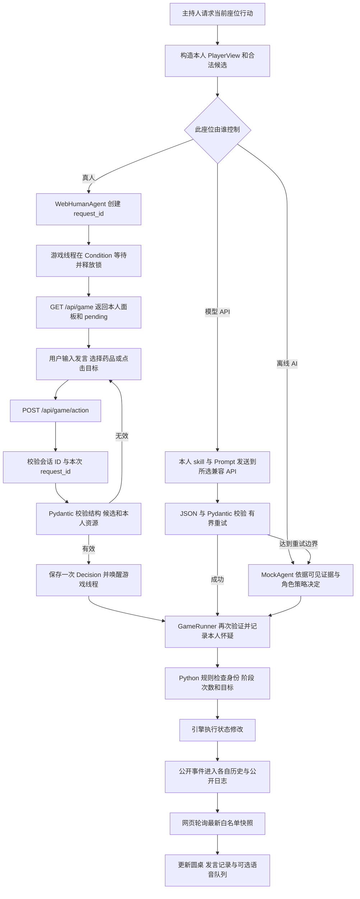
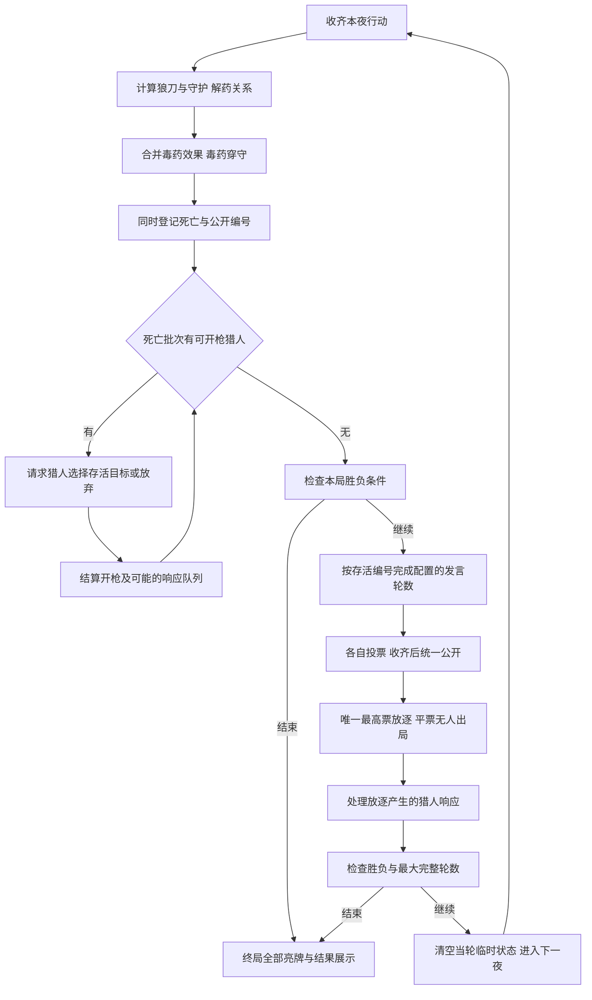

# 从用户输入到游戏结算

本项目采用本地浏览器界面、Python 主持人和 LangGraph 顺序编排。浏览器按固定间隔读取玩家可见快照，游戏线程在需要真人决定时等待一次结构化提交。

## 开局流程

`GameConfig` 在程序接口中保留 `classic8` 默认值，以兼容原有调用。网页与命令行入口默认选择 `standard12`。角色数量来自预设，UI 和 Agent 创建都使用同一人数来源。

## 每次真人输入

`request_id` 标记某个具体输入机会。重复点击的提交会被拒绝，旧请求也不能变成下一次投票或下一夜技能。前端同时比较轮询序号与会话 ID，避免较晚返回的旧响应覆盖新输入面板。

## 夜晚、死亡响应与白天

猎人被毒时直接失去本次开枪资格。普通玩家死亡后停止行动，持有引擎授予响应资格的猎人是明确的例外。12 人局使用屠边，8 人局使用原有人数优势规则。

## 信息和线程边界

| 数据或动作 | 所在位置 | 可见范围 |
| --- | --- | --- |
| 全部真实身份与待结算行动 | `GameEngine.state` | Python 主持人 |
| 本人身份、skill、私有笔记 | `PlayerView` | 该座位的 Agent 或本人网页面板 |
| 女巫刀口 | 本人视图且解药仍可用 | 女巫 |
| 查验真实阵营 | 本人记忆 | 预言家 |
| 待结算选票 | 主持人状态 | 收齐后统一公开 |
| API Key | 本地环境或后端内存 | 所选接口客户端 |
| 浏览器保存的偏好 | localStorage | 接口 ID 与声线偏好 |
| 标签页恢复信息 | sessionStorage | 当前随机会话 ID |
| 发言朗读 | `SpeechQueue` | 公共发言按顺序播放 |

规则写入与快照读取使用 `engine.lock`。真人等待使用另一把 `Condition`，等待时释放该锁，并且不会持有状态锁。HTTP 处理线程因此仍可以读取局面、接受输入和结束对局。

## 代码阅读顺序

1. 从 `play_web.py` 和 `web/server.py` 看服务与路由。
2. 从 `web/static/app.js` 看开局、轮询与提交输入。
3. 从 `web/session.py` 看真人等待、请求去重和后台线程。
4. 从 `game/state.py` 看真实状态与独立可见信息。
5. 从 `game/runner.py` 看如何选择 Agent 和合法候选。
6. 从 `agents/skills.py`、`role_skills/` 和 `agents/prompts.py` 看角色知识加载。
7. 从 `game/rules.py` 和 `game/engine.py` 看确定性校验及执行。
8. 从 `workflow/graph.py` 看循环与胜负路由。
9. 从 `web/static/speech.js` 看可替换的语音输出接口。

## 发言播放与夜间显示

网页开局启用 playback_sync。公开 AI 发言发布后，后台在引擎锁之外等待当前 playback_id 的确认。浏览器根据声线播放音频并推进字幕，完成后 POST /api/game/playback，主持人再调用下一位。刷新继续当前发言，停止唤醒等待。

非狼人夜晚覆盖黑色遮屏，轮到本人的技能时仅抬高行动面板。公开投票、下一夜与终局展示均跟随当前发言完成确认。
